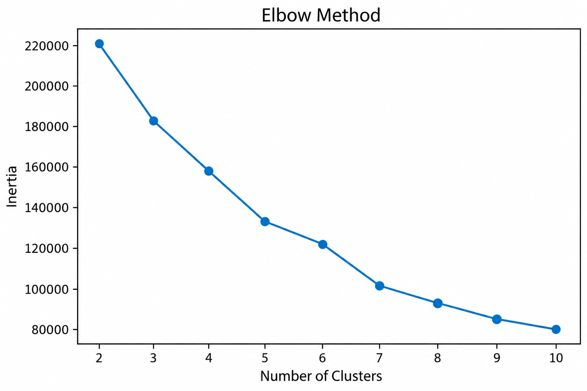
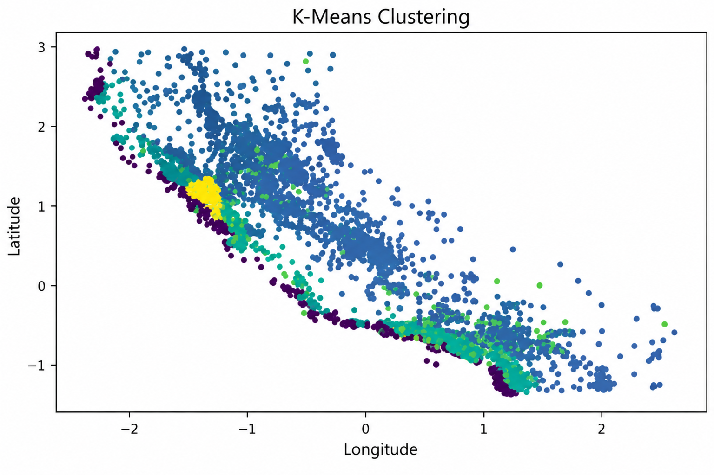

# Machine Learning Capstone Project

**Regression · Classification · Clustering on the California Housing Dataset**

| | |
|---|---|
| **Student** | Saad Fakry Saad |
| **Major** | Computer Science (CS) |
| **Supervisor** | Dr. Abdelrahman Haidar |
| **University** | Badr University in Assiut – Faculty of Artificial Intelligence & Data Management |
| **GitHub** | [Aboleila-Engineer](https://github.com/Aboleila-Engineer) |

## Quick Links

- 📄 **Final report:** [project_report_machine.pdf](project_report_machine.pdf)
- 📓 **Google Colab notebook:** [Open in Colab](https://colab.research.google.com/drive/1pXIdQXmVC2CWclSmOsrkLcm6-CwGs_iM?usp=sharing)
- 📓 **Local notebook:** [ML_Capstone_Project.ipynb](ML_Capstone_Project.ipynb)

## Project Overview

This project covers the full machine learning pipeline: data loading, cleaning, EDA, preprocessing, modeling with three algorithm types, evaluation, and reporting.

| Task | Model | Target |
|---|---|---|
| Regression | Linear Regression | `median_house_value` |
| Classification | Logistic Regression | `high_value` (1 if house value > dataset median, else 0) |
| Clustering | K-Means | No label (all 13 scaled features) |

## Dataset

- **Name:** California Housing Prices (1990 U.S. Census), from Kaggle
- **File:** `housing.csv`
- **Size:** 20,640 rows × 10 columns (13 features after one-hot encoding)
- **Features:** longitude, latitude, housing_median_age, total_rooms, total_bedrooms, population, households, median_income, ocean_proximity (categorical)

## Preprocessing

1. Filled 207 missing `total_bedrooms` values with the median.
2. One-Hot Encoded `ocean_proximity`.
3. Standardized features with `StandardScaler` (fit on the training set only for supervised tasks).
4. 80% / 20% train-test split with `random_state=42`.

## Results

| Task | Model | Result |
|---|---|---|
| Regression | Linear Regression | MSE ≈ 4.91 × 10⁹, **RMSE ≈ $70,061**, **R² = 0.625** |
| Classification | Logistic Regression | **Accuracy = 83.79%**, Precision 0.83, Recall 0.84 |
| Clustering | K-Means (K = 5) | **Silhouette Score = 0.361** |

Confusion matrix (test set): TN = 1718, FP = 347, FN = 322, TP = 1741.

### Visualizations

| Elbow Method | K-Means Clusters |
|---|---|
|  |  |

## Repository Structure

```text
ML-Capstone-Project/
├── ML_Capstone_Project.ipynb
├── housing.csv
├── project_report_machine.pdf
├── elbow_method.png
├── kmeans_clusters.png
├── requirements.txt
└── README.md
```

## How to Run

### Option 1 – Google Colab (easiest)
Open the [Colab notebook](https://colab.research.google.com/drive/1pXIdQXmVC2CWclSmOsrkLcm6-CwGs_iM?usp=sharing), run the first cell, and upload the repository's `housing.csv` when asked. Then run the remaining cells in order.

### Option 2 – Locally

```bash
git clone https://github.com/Aboleila-Engineer/ML-Capstone-Project.git
cd ML-Capstone-Project

python -m venv venv
source venv/bin/activate        # Windows: venv\Scripts\activate
pip install -r requirements.txt

jupyter notebook ML_Capstone_Project.ipynb
```

> The first notebook cell uses `google.colab.files.upload()`. When running locally, skip it and load the data with `pd.read_csv("housing.csv")`.

## Conclusions and Next Steps

- Linear Regression explains ~62.5% of the variance; `median_income` is the strongest predictor.
- Logistic Regression separates high- and low-value districts with ~84% accuracy and balanced errors.
- K-Means assigns the processed records to 5 clusters. Cluster labels are exploratory, not validated market segments.
- Next steps: Random Forest / Gradient Boosting, feature engineering, PCA, cross-validation.

## Reproducibility note

The notebook begins with a Google Colab upload cell. For local Jupyter use, skip that cell and run from the repository root; the next cell already reads `housing.csv`. Package versions are not pinned. Saved outputs and report results are from the recorded run, not a new benchmark.
